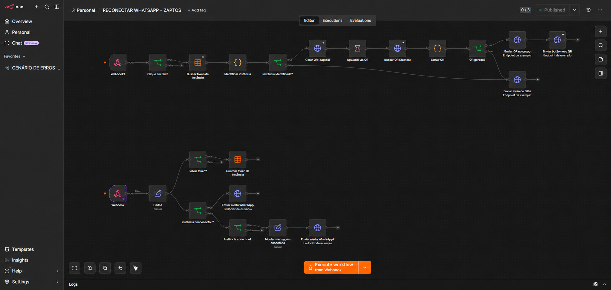

# Reconexão de instâncias WhatsApp com n8n

Versão demonstrativa de uma automação que desenvolvi para uso no trabalho. O fluxo recebe eventos de conexão de instâncias de uma API não oficial de WhatsApp, avisa um grupo quando uma instância desconecta e permite solicitar um novo QR Code por botão. Quando a instância volta a conectar, envia uma confirmação.

## Visão do fluxo

*Captura ilustrativa do fluxo em uso. Os trechos de URLs foram substituídos por texto de exemplo para a publicação.*

O arquivo [`workflow.demo.json`](workflow.demo.json) conserva os 22 nós e as conexões principais da automação. Foi preparado para mostrar a arquitetura, **não para execução imediata**.

## Como funciona

1. Um webhook recebe o estado da instância. O fluxo identifica desconexões e reconexões.
2. Na desconexão, o grupo recebe um aviso com botão para solicitar a reconexão.
3. O clique chega a um segundo webhook. O fluxo identifica a instância e consulta seu token em uma tabela do n8n.
4. O fluxo solicita e consulta o QR Code pela API, envia a imagem ao grupo e oferece um botão para gerar outro QR Code se ele expirar.
5. Se não encontrar a instância ou o QR Code, envia um aviso de falha.

## Tecnologias

n8n · Webhooks · Requisições HTTP · JavaScript · Tabela de dados do n8n · API Zaptos

## Antes de usar

- Importe `workflow.demo.json` no n8n.
- Configure os dois webhooks na integração de eventos e botões usada no seu ambiente.
- Crie uma tabela de dados no n8n com as colunas `groupId`, `instanceName` e `token`. Selecione essa tabela nos nós **Guardar token da instância** e **Buscar token da instância**.
- Substitua os grupos fictícios `GRUPO_ALPHA@g.us`, `GRUPO_BETA@g.us` e `GRUPO_TESTE@g.us` pelos grupos autorizados no nó **Dados**. Ajuste os nomes das instâncias.
- Substitua `SUBSTITUA_PELO_TOKEN_DA_INSTANCIA_DE_ALERTAS` e os endereços `example.invalid` pelos valores e endpoints do seu ambiente. Configure as credenciais fora do arquivo compartilhado antes de ativar o fluxo.
- Teste com instâncias e grupos de teste. A estrutura dos eventos e endpoints pode variar conforme a API utilizada.

## Dados removidos da versão pública

Foram removidos dados de execução fixados no editor, URLs reais, tokens, telefones, nomes de clientes, IDs de grupos, caminhos de webhook, IDs da tabela e identificadores internos do fluxo. Os valores `example.invalid` e `GRUPO_*@g.us` são marcadores fictícios e não representam destinos operacionais.

Este repositório documenta uma implementação de portfólio. Não contém acesso ao ambiente de trabalho nem é uma integração oficial do WhatsApp.

